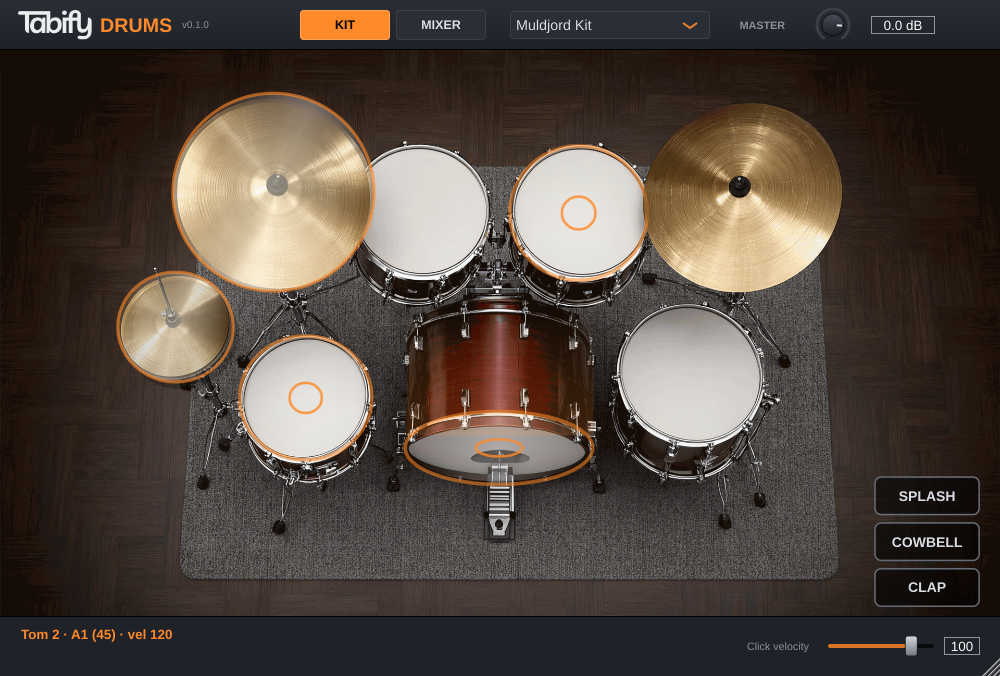
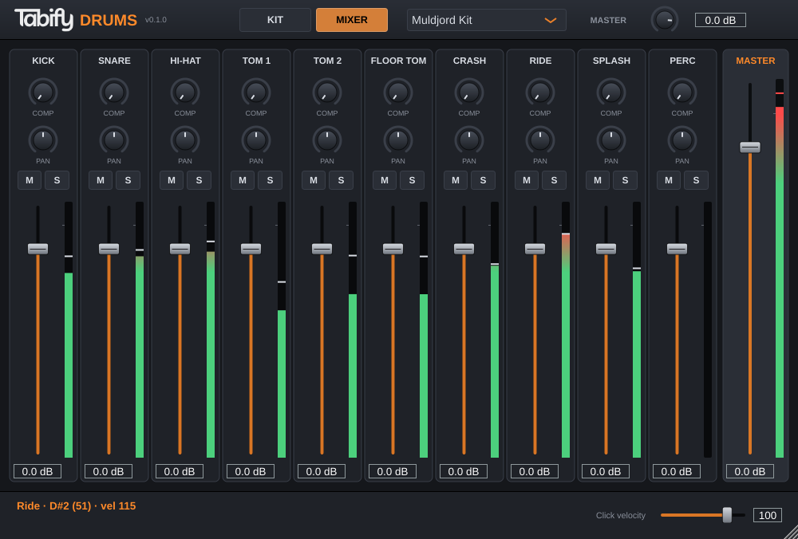

# Tabify Drums

**English** · [Русский](README.ru.md)



A free, open-source, cross-platform drum sampler plugin — VST3, CLAP, LV2, AU and
Standalone — built with JUCE 8.

## Features

- **Two built-in kits**, switchable from the header:
  - **Muldjord Kit** (default) — a multi-mic acoustic kit from [DrumGizmo](https://drumgizmo.org),
    mixed down per instrument from close, overhead and room microphones.
  - **GM Rock Kit** — from the [Hydrogen](https://github.com/hydrogen-music/hydrogen) project.
- **18 articulations** with 5 velocity layers each: kick, snare / rimshot / side stick,
  hi-hat closed / semi-open / open / pedal with choke, two rack toms, floor tom, crash,
  ride / bell / 24" ride, splash, cowbell, hand clap.
- **General MIDI note map** and **MIDI learn** for every articulation (right-click a drum).
- **Interactive kit photo**: drums light up and ripple, cymbals swing and shine,
  the hi-hat opens — and you can play it with the mouse.
- **Mixer**: 10 channels plus master with fader, pan, one-knob compressor,
  mute / solo and level meters.
- Resizable UI; everything is saved with your DAW project.



## Install

Download the archive for your platform from
[Releases](https://github.com/destshotGuitar/tabify-drums/releases), unzip it and copy
the format you need to your plugin folder:

| Format | Windows | macOS | Linux |
|---|---|---|---|
| VST3 | `C:\Program Files\Common Files\VST3` | `~/Library/Audio/Plug-Ins/VST3` | `~/.vst3` |
| CLAP | `C:\Program Files\Common Files\CLAP` | `~/Library/Audio/Plug-Ins/CLAP` | `~/.clap` |
| LV2 | `%APPDATA%\LV2` | `~/Library/Audio/Plug-Ins/LV2` | `~/.lv2` |
| AU | — | `~/Library/Audio/Plug-Ins/Components` | — |

The builds are not code-signed. On macOS, remove the quarantine flag after copying, e.g.
`xattr -dr com.apple.quarantine ~/Library/Audio/Plug-Ins/VST3/"Tabify Drums.vst3"`.
On Windows, SmartScreen may warn about the Standalone app: *More info → Run anyway*.

## Default notes (GM)

| Note | Articulation | Note | Articulation |
|---|---|---|---|
| 35, 36 | Kick | 48, 50 | Tom 1 |
| 38 | Snare | 45, 47 | Tom 2 |
| 40 | Rimshot | 41, 43 | Floor Tom |
| 37 | Side Stick | 49, 57 | Crash |
| 42 | Hi-Hat Closed | 51 | Ride |
| 23 | Hi-Hat Semi-Open | 53 | Ride Bell |
| 46 | Hi-Hat Open | 59 | Ride 24" |
| 44 | Hi-Hat Pedal | 55 | Splash |
| 39 | Hand Clap | 56 | Cowbell |

## Build from source

```bash
git clone --recursive https://github.com/destshotGuitar/tabify-drums.git
cd tabify-drums
cmake -S . -B build -G Ninja -DCMAKE_BUILD_TYPE=Release
cmake --build build --target TabifyDrums_All TabifyDrums_CLAP
```

Plugins end up in `build/TabifyDrums_artefacts/Release/`. On Linux,
`scripts/install.sh` builds and installs VST3, CLAP and LV2 for the current user.

Linux dependencies (Fedora names; Debian/Ubuntu equivalents are in
`.github/workflows/build.yml`):

```bash
sudo dnf install cmake ninja-build gcc-c++ alsa-lib-devel pipewire-jack-audio-connection-kit-devel \
  freetype-devel fontconfig-devel libX11-devel libXrandr-devel libXinerama-devel libXcursor-devel
```

### Tests

```bash
cmake --build build --target TabifyDrumsTestHost TabifyDrumsSnapshot
build/TabifyDrumsTestHost_artefacts/Release/TabifyDrumsTestHost "build/TabifyDrums_artefacts/Release/VST3/Tabify Drums.vst3" out
build/TabifyDrumsSnapshot out
```

`TabifyDrumsTestHost` loads the VST3 like a DAW and checks every articulation,
velocity layers, kit switching and state restore, and renders `out/beat.wav`.
`TabifyDrumsSnapshot` saves screenshots of the editor.

### Customising

- **Samples** live in `resources/kits/<kit>/`, five files per articulation from
  `-Softest` to `-Hardest`. Kits are listed in `src/KitDefinition.h`.
- **DrumGizmo kits** can be converted with `tools/import_drumgizmo.py`;
  `scripts/import_muldjord.sh` rebuilds the Muldjord Kit from the DrumGizmo archive.
- **UI**: kit photo `resources/ui/kit.jpg`, logo `resources/ui/logo.png`, colours in
  `src/gui/DrumLookAndFeel.h`, click zones in `src/gui/DrumKitView.cpp`.

## Roadmap

Groove library and fill generator synced to the host tempo, per-channel outputs,
EQ and reverb, presets, e-drum mode, loading external kits, UI translations.

## License

The source code is licensed under the [GNU AGPLv3](LICENSE), as required by JUCE's
open-source licence.

Samples: Muldjord Kit — CC BY 4.0 (DrumGizmo.org), GM Rock Kit — GPL (Glen MacArthur /
Sebastian Moors); see [`resources/kits/CREDITS.md`](resources/kits/CREDITS.md).
The kit photo and the Tabify logo in `resources/ui/` are not covered by the AGPL and
belong to their respective owners.

Third-party code: [JUCE](https://juce.com) (AGPLv3),
[VST3 SDK](https://github.com/steinbergmedia/vst3sdk) (MIT),
[CLAP](https://github.com/free-audio/clap) and
[clap-juce-extensions](https://github.com/free-audio/clap-juce-extensions) (MIT).
